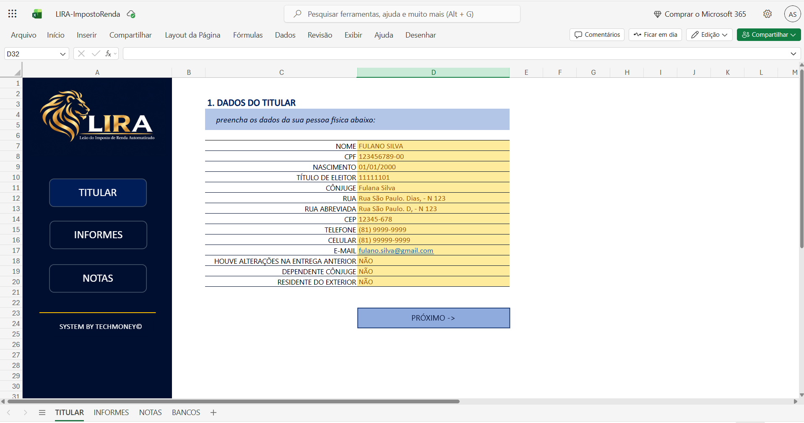
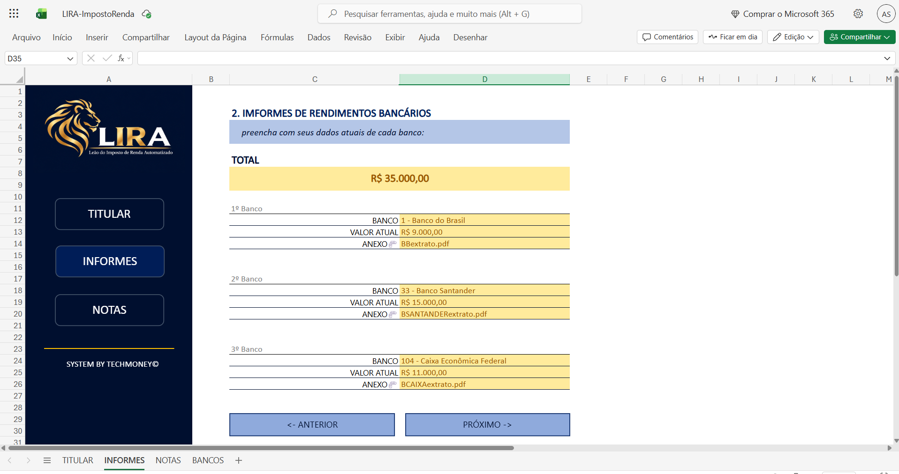
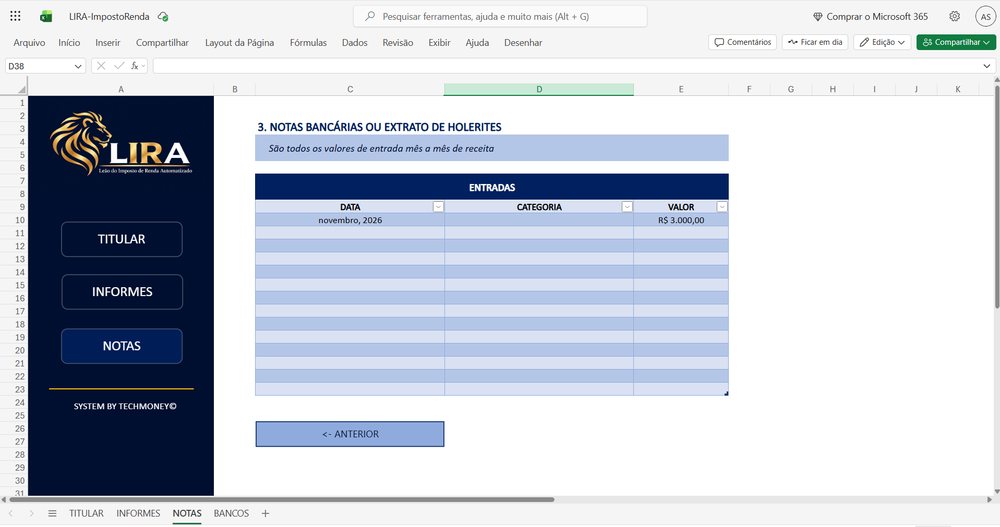

    

-------
 

<h1 align="center">LIRA - Leão do Imposto de Renda Automatizado</h1>
 
Projeto realizado no Excel nomeado com a sigla LIRA (Leão do Imposto de Renda Automatizado) possui como propósito ser um organizador de informações e dados para imposto de renda. Nele é possível adicionar informações pessoais, informações sobre rendimentos bancários e extratos de holerites, auxiliando usuários que procuram praticidade de organizar seus dados afim de ter maior facilidade e não esquecer dados importantes para adicionar a declaração do IR.
 
 

## 💻 Passo a passo:

- TELA DO TITULAR: O usuário deve digitar todas as informações de pessoa física que é solicitada na primeira tela, depois deve confirmar se está tudo respondido e sem erros e clicar no botão de "próximo".
  
- TELA INFORMAÇÕES DE RENDIMENTOS BANCÁRIOS: O usuário deve preencher informações sobre o rendimentos atuais que tem em suas contas bancárias, sendo no mínimo de um banco e podendo adicionar informações sobre mais bancos logo abaixo. inserir o valor do saldo e disponível e anexar arquivo do extrato da conta. Na parte superior da 2ª tela o usuário verá o total do valor que foi somado. Depois deve confirmar se está tudo respondido e sem erros e clicar no botão de "próximo".
  
- TELA EXTRATO DE HOLERITES: O usuário deve adicionar os valores de entrada mês a mês da receita, inserindo datas, escolhendo entre categorias de Holerite, CNPJ e Freelancer e o valor da entrada. Depois deve confirmar se está tudo respondido e sem erros e finalizar a operação.
  
- TELA DE BANCOS: A tela de informações sobre os códigos de bancos serviu para ser adicionado na tela de informe de rendimentos como um menu de opções para o usuario não precisar digitar e correr o risco de errar o código exato do banco cadastrado.

## 🦁 Benefícios de Utilização da Ferramenta:

- Auxilia na organização dos dados necessários para a real declaração de Imposto de Renda.
- Prático e rápido para preencher todos os fórmularios.
- Faz cálculo real

## ⚠️ Avisos Importantes:
- Apenas um simulador, não salva informações pessoais.
- Feito com Excel